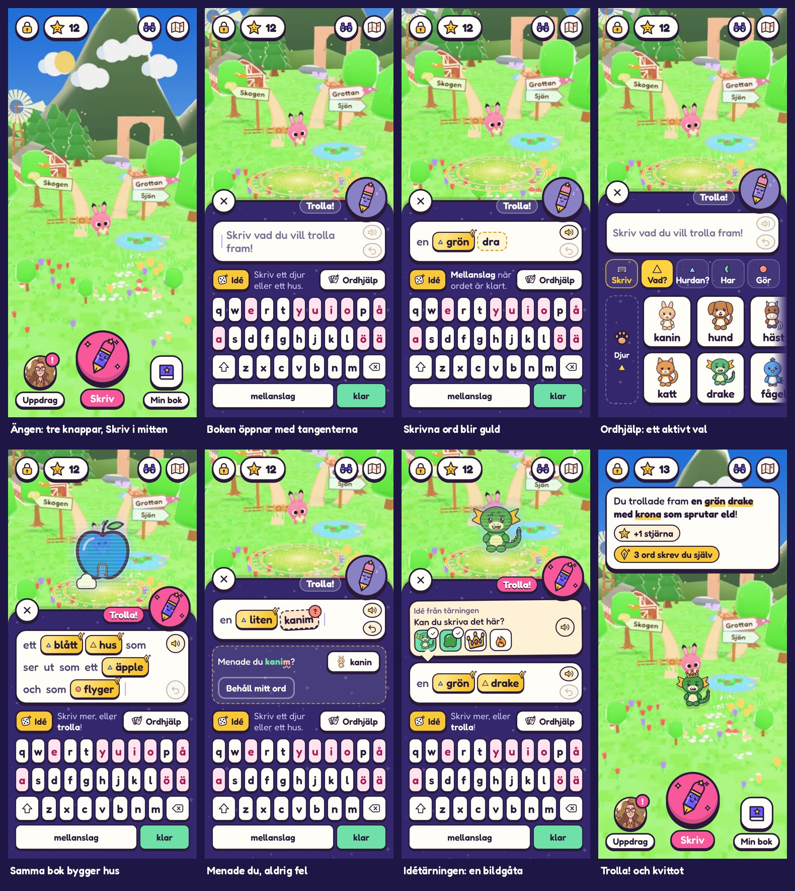
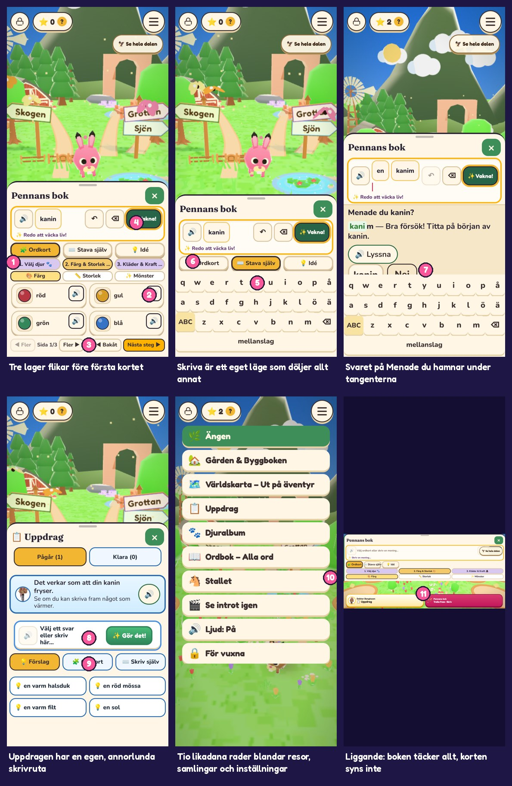
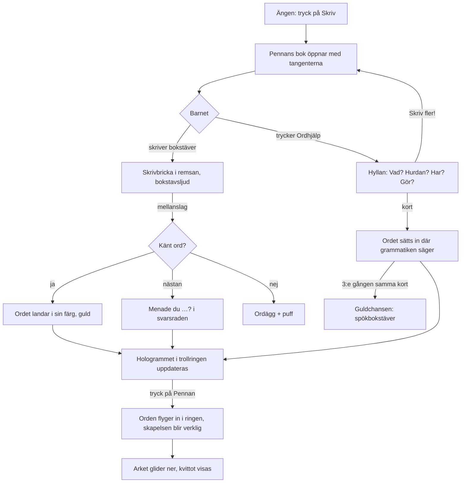

# Nya Skapa: Pennans bok, skriv först

**Version 1 · 2026-10-29 · Underlag för implementering i Trollpennan**
Utgår från `main` = `9932512` (#254, block 3 formsystemet).

Det här dokumentet beskriver hur menysystemet och Skapa-flödet ska se ut och fungera. Allt som behövs för att bygga det finns i paketet: klickbar prototyp, texter, ikoner, designvariabler, skärmbilder och en faslista med acceptanskrav. Prototypen (`prototyp/skapa-prototyp.html`) är facit för utseende och beteende; där dokumentet och prototypen skiljer sig gäller dokumentet.



---

## 1. Beslutet i korthet

1. **Skriva själv är förstahandsvalet.** Pennans bok öppnar med tangenterna. Inga förslag dyker upp av sig själva.
2. **Hjälp är ett aktivt val.** Knappen **Ordhjälp** byter tangenterna mot en hylla med bildkort. Hjälporden är en liten del av allt som går att skapa; resten finns bara för den som skriver (skrivord).
3. **En bok för allt.** Djur, hus, natur, lek, önskningar, uppdrag, gåvor och bygg om använder samma ark. Uppdragsvyns egen skrivruta och knappen *Gör det!* försvinner.
4. **Ängen syns hela tiden.** Arket täcker högst nedre ~60 %. Det man skriver växer fram som ett **hologram i trollringen** på ängen, ord för ord.
5. **Meningen är hjälten.** Varje ord i meningen får färg och form efter frågan det svarar på: **Vad? Hurdan? Har? Gör?** (Montessoris grammatiksymboler). Samma kod på flikar, kort och ord.
6. **Pennan trollar.** Trolla-knappen är maskoten Pennan, placerad som ett öra på arkets övre högra hörn. Den sover tills meningen har ett *Vad*.
7. **Skrivande belönas, aldrig krävs för att spela.** Ord som barnet skrivit själv blir guld. Felstavning ger *Menade du …?* med det rätta markerat; fel böjning ger en vänlig bubbla. Aldrig rött, aldrig tyst rättning.
8. **Menysystemet krymper till tre knappar.** Nertill: **Uppdrag**, **Skriv** (stor, i mitten) och **Min bok**. Hamburgermenyn försvinner; resor ligger under **Karta** uppe till höger.

---

## 2. Nuläget: varför det behöver göras om

Skärmbilderna är tagna i 375×812 på `main` den 29 oktober (`skarmar/nulage/`). Siffrorna hänvisar till `skarmar/nulage-problem.jpg`.



| # | Problem | Följd för barnet |
|---|---|---|
| 1 | Tre lager flikar (Ordkort/Stava själv/Idé, steg 1–3, Färg/Storlek/Mönster) och 13 tryckytor innan första kortet | Svårt att veta var man är; ser ut som ett formulär |
| 2 | En högtalarknapp på varje kort, som dessutom krockar med *Vald*-märket | Dubbelt så många tryckytor, plottrigt |
| 3 | Fyra kort per sida och sidbläddring *Sida 1/3, Fler ▶* | Barnet ser inte vad som finns; bläddrandet känns som läxa |
| 4 | Meningsrutan har fyra små knappar och en statusrad (*Redo att väcka liv!*) som upprepar knappen | Meningen, det viktigaste, drunknar |
| 5 | *Stava själv* är ett eget läge som döljer allt annat | Att skriva känns som en omväg, inte som spelets verb |
| 6 | Ordkort är förvalt och ligger först | Barnet lär sig att välja, inte att skriva |
| 7 | Svaret på *Menade du …?* hamnar under tangentbordet | Barnet kan inte svara (bugg) |
| 8 | Uppdragen har en egen skrivruta med *Gör det!* och egna flikar | Två olika sätt att göra samma sak |
| 9 | Ordkort och förslag ser olika ut i boken och i uppdragen | Inget visuellt språk att lära sig |
| 10 | Huvudmenyn är tio likadana rader som blandar platser, samlingar och inställningar | Inget sticker ut; vuxensaker ligger bland barnsaker |
| 11 | Liggande: boken täcker hela skärmen och korten syns inte | Oanvändbart på surfplatta eller liggande telefon |

Även: emoji som ikoner (renderas olika per telefon), realistiska målade kortbilder bredvid kitets klistermärken, verbet *Vakna!* som inte passar hus, och att boken döljer ängen där skapelsen dyker upp. Byggen saknar helt kort (*Nästa steg 1* i `docs/en-varld/STATUS.md`).

---

## 3. Principer

1. **Skriv först, hjälp på begäran.** Tangenterna är standardläget. Hjälp visas bara när barnet ber om den, och den knuffar tillbaka mot skrivandet (*Skriv fler!*, guldchansen, spökbokstäver).
2. **Det jag skriver syns.** Varje ord ändrar hologrammet direkt. Ett ord som inte kan ritas blir ett ordägg, aldrig ingenting.
3. **Färg och form = ordklass.** Barnet lär sig ordklasser genom att se dem, inte genom att höra namnen.
4. **Allt hörs.** Varje tangent säger sin bokstav, varje ord kan läsas upp, högtalaren läser upp exakt det som står (också felstavat). *Håll inne* på ett kort = bara lyssna.
5. **En plats, ett sätt.** Samma ark, samma remsa, samma pennknapp i alla lägen. Lappen överst säger vad som är speciellt just nu.
6. **Klistermärken, inte formulär.** Konstkitets stil överallt: plommonfärgad kontur, hård leksaksskugga, platta färger, Fredoka.
7. **Ingen skam.** Inga röda kryss, inga felljud, inga låsta ord. Allt barnet skriver sparas.

---

## 4. Inspiration: vad vi lånar och varför

| Från | Vad vi lånar | Var det syns |
|---|---|---|
| **Slime Rancher** | Mjuka klistermärkesknappar med hård skugga; *Vacpack*-känslan att verktyget alltid är med; byggplatsen som visar vad som byggs innan det byggs | Pennan som stor mittknapp, trollringen med hologram, leksaksskuggor |
| **Minecraft** (kreativa inventariet) | Kategoriflikar med ikoner över ett rutnät av föremål; en sökflik där man skriver | Ordhjälpens frågeflikar och hylla; *Skriv*-fliken först |
| **Scribblenauts** | Kärnfantasin: skriv vad som helst och det dyker upp; *Menade du …?* när stavningen glider | Hela flödet; svarsraden |
| **Att skriva sig till läsning** (svensk skolmetod med talsyntes) | Barnet skriver på skärm och hör direkt vad det skrivit, även fel | Bokstavsljud på tangenterna, högtalaren som läser exakt det som står |
| **Montessoris grammatiksymboler** | Substantiv = triangel, adjektiv = mindre triangel, preposition = halvmåne, verb = cirkel | Ordklassmärkena på flikar, kort och ord (färgen på substantivet är gul i stället för svart, så den syns på det mörka arket) |
| **Toca Boca / Animal Crossing** | Inga felmeddelanden; allt man rör vid svarar med ljud och studs | Studsar, gnistor, uppläsning vid tryck |

---

## 5. Flöden



**Önskan, uppdrag, gåva, bygg om och tomt** öppnar samma ark med en **lapp** överst (avsnitt 6.9). Allt annat är likadant.

| Ingång | Lapp | Startläge | Glödande kort i Ordhjälp |
|---|---|---|---|
| Skriv-knappen i HUD:en | ingen | tangenterna (eller Ordhjälp om föräldern valt det) | – |
| Djurets önskan (bubblan) | *Kaninen önskar sig …* + djurets bild | tangenterna | korten som uppfyller önskan (`onskaIds`) |
| Uppdrag → *Svara med pennan* | *Uppdrag från Doktor Bengtsson* + porträtt | tangenterna | korten i `uppdragForslag` |
| Gåva till ett djur (`gavaTill`) | *Present till kaninen* + Döp-knappen | tangenterna | gåvokorten (`GAVOR`) |
| Tryck på ledig tomt | *Här ska det byggas* + tomtens nummer | tangenterna | – (Ordhjälp öppnar på Vad? → Hus) |
| Bygg om (`omUidRef`) | *Bygg om {bygge}* + byggets formel i remsan | tangenterna | – |

---

## 6. Skärmar och komponenter

Alla mått gäller 375×812 stående. Text minst 18 px, ord i meningen och på kort 22 px, tryckytor minst 44 px (projektreglerna). Färger och mått som variabler: `stil/skapa-tokens.css`. Referens-CSS från prototypen: `stil/skapa-referens.css`.

### 6.1 HUD

**Topp:** `[lås (håll inne)] [⭐ 12]` … `[kikare: Se hela dalen] [karta: Karta]`. Runda klistermärkesknappar 48 px med ikonerna `ui/las`, `ui/stjarna`, `ui/dalen`, `ui/karta`. *Se hela dalen* blir en ikon i stället för en textskylt. *Till Ängen* (på andra platser) behålls som pill till vänster.

**Botten (bara på ängen, döljs när ett ark är öppet):**

| Knapp | Utseende | Gör |
|---|---|---|
| **Uppdrag** (vänster) | Bengtssons porträtt i cirkel 66 px, rosa bricka med `!` när något nytt finns, etikett *Uppdrag* | Öppnar Uppdragsarket (6.13) |
| **Skriv** (mitten) | Rosa cirkel 104 px med Pennan (`ui/skapa/penna-redo.svg`), andas långsamt, etikett *Skriv* | Öppnar Pennans bok |
| **Min bok** (höger) | Bok-ikonen 66 px | Öppnar Min bok (6.12) |

Ersätter `HudBot` (*Doktor Bengtsson Uppdrag* / *Pennans bok Trolla fram · Skriv*) och hamburgermenyn i `Hud`/`MenyPanel`.

### 6.2 Pennans bok (arket)

Ett ark som glider upp nerifrån (420 ms, `--tp-mjuk`). Bakgrund `--tp-natt` med stjärnmönstret `ui/skapa/ark-stjarnor.svg`, 4 px plommonkant upptill, hörnradie 30 px.

Uppifrån och ner:

```
 ( X )                               [Trolla!]( Pennan )   ← öron som sticker upp ovanför arket
┌───────────────────────────────────────────────────────┐
│ [Lappen: önskan / uppdrag / idé …]          (valfri)   │
│ ┌ Trollremsan ───────────────────────────────┐        │
│ │ en  ▲grön  ▲drake  dra|               🔊 ↶ │        │
│ └────────────────────────────────────────────┘        │
│ [Svarsraden: Menade du … / böjning / guldchans] (valfri)│
│ [🎲 Idé]  Mellanslag när ordet är klart.  [Ordhjälp]   │  ← Hjälpraden (bara i skrivläge)
│ q w e r t y u i o p å                                  │
│ a s d f g h j k l ö ä                                  │  ← Tangenterna (vokaler rosa)
│ ⇧ z x c v b n m ⌫                                      │
│ [      mellanslag      ] [ klar ]                      │
└───────────────────────────────────────────────────────┘
```

I **Ordhjälpsläget** ersätts hjälpraden och tangenterna av frågeflikarna och hyllan (6.7).

- **Stäng:** X-örat uppe till vänster, tryck på ängen, Escape eller Android-bakåt. Det skrivna sparas tills barnet trollar eller suddar (som i dag, `textRef`).
- **Höjd:** innehållet bestämmer. Med tangenter ca 480 px (topp ca y = 330), med Ordhjälp ca 420 px. Världen ovanför flyttas av kameran (6.10) så att trollringen alltid syns.
- **Liggande** (bredd > höjd): arket blir en panel till höger, `min(400px, 52%)` bred. X och Pennan hänger på panelens vänsterkant mot ängen. Tangenterna 38 px höga. Trollringen hamnar mitt i den synliga ängen. HUD:ens högerknappar flyttar vänster om panelen.

### 6.3 Trollremsan (meningen)

En vit klistermärkesremsa (radie 22, kant 3, hård skugga) som visar meningen som **ordbrickor** i barnets ordning.

| Bricka | Utseende |
|---|---|
| Innehållsord (Vad/Hurdan/Har/Gör) | Fylld i ordklassens färg, 2,5 px kant, ordklassmärket (15 px) före ordet, 22 px |
| Småord (en, ett, med, som, av, och, ser, ut) | Ingen ruta, dämpad plommonfärg, 22 px |
| Guldord (skrivet själv) | Guldgradient som glänser långsamt + liten guldpenna i hörnet |
| Skrivbrickan (ordet som skrivs nu) | Streckad guldkant, blinkande lila markör. Spökbokstäver visas ljusgrå efter markören |
| Fråga (*kanim*) | Streckad, vickar, rött-orange `?`-märke. Svarsraden visar förslagen |
| Böjningsfel (*ett stor*) | Streckad, vickar, blått `?`-märke. Svarsraden förklarar |
| Ordägg | Gräddvit med äggikonen |
| Tom plats (bara när hjälpkort lagt ett adjektiv utan substantiv) | Streckad gul *vad?* som pulserar; tryck = Ordhjälp → Vad? |

- **Tom remsa i skrivläge:** markören blinkar och *Skriv vad du vill trolla fram!* står i dämpad text efter den.
- **Verktyg** till höger i remsan: **Lyssna** (läser upp exakt det som står, inklusive skrivbrickan) och **Ångra** (stegvis, max 24 steg, som `angraStackRef`).
- **Tryck på en bricka:** läser upp ordet och markerar det med lila ring och ett runt **×** för att ta bort. Ett ord från ett hjälpkort tas bort tillsammans med sina automatiska småord (*med* hatt).
- **Lång mening:** remsan växer till tre rader, sedan rullar den inuti. Ingen sammanfattningsknapp (*✏️ Ändra orden* försvinner).

### 6.4 Pennan (Trolla-knappen)

- Ett öra uppe till höger: cirkel 84 px, 4 px kant, skugga 6 px. Etiketten **Trolla!** som en pill till vänster om den.
- **Sover** (`penna-vilar.svg`, gråviolett) tills meningen har ett *Vad* och ingen öppen fråga. Tryck när den sover: Pennan skakar och puffen *Skriv vad du vill trolla fram först …* läses upp. Inget annat händer.
- **Redo** (`penna-redo.svg`, rosa bakgrund): vickar till var 1,8 s. Etiketten blir rosa.
- **Trollar** (`penna-trollar.svg`): under trollögonblicket (6.11).
- Ersätter *✨ Vakna!*-knappen. Texten **Trolla!** passar både djur, hus och saker.

### 6.5 Hjälpraden

Under remsan i skrivläge: `[🎲 Idé]  tipstext  [Ordhjälp]`.

| Läge | Tipstext (`skapa-ui.json` → `hjalprad`) |
|---|---|
| Tom mening | *Skriv ett djur eller ett hus.* |
| Mitt i ett ord | ***Mellanslag** när ordet är klart.* |
| Meningen har ett Vad | *Skriv mer, eller **trolla**!* |
| Barnet har stått still mitt i ett ord i 7 s | *Behöver du hjälp? Tryck på **Ordhjälp**.* och knappen pulserar (inga förslag visas) |
| Guldchansen | *Skriv **kanin**. Spökbokstäverna visar vägen.* och **Hör** ersätter Ordhjälp |

### 6.6 Tangentbordet

- Data som i dag: `data/tangentbord.json`. Tre bokstavsrader, sedan `[mellanslag][Trolla!]`.
- **Vokalerna** (a e i o u y å ä ö) har rosa botten och mörkrosa bokstav.
- Tangenter 50 px höga, radie 11, kant 2,5, skugga 3 px. Skift visar *stor bokstav* för nästa tangent och släpper sedan.
- **Bokstavsljud:** varje tangent säger sin bokstav (ljudet, inte namnet). Föräldern kan stänga av det.
- **Mellanslag:** avslutar ordet, utom när det påbörjade ordet är början på ett flerordsuttryck (*sprutar* → *sprutar eld*), då läggs mellanslaget till i ordet.
- **Trolla!:** avslutar påbörjat ord och använder samma skapande och animation som Pennan. Tom mening ger en vänlig puff.
- **Sudda (⌫):** tar bort en bokstav. Är skrivbrickan tom flyttas det sista ordet tillbaka in i brickan så att barnet kan rätta det.
- Det fysiska tangentbordet på dator fungerar likadant: Enter = Trolla, även när sista ordet ännu inte avslutats. Andra fokuserade knappar behåller vanlig tangentbordsaktivering.

### 6.7 Ordhjälpen

Öppnas med knappen **Ordhjälp** (eller som startläge om föräldern valt *Ordhjälpen först*). Tangenterna ersätts av:

**Frågeflikarna:** `[⌨ Skriv] [▲ Vad?] [▲ Hurdan?] [☾ Har] [● Gör]`. Fem lika breda flikar, ikon ovanför text. Vald flik är fylld i ordklassens färg; *Skriv* har guldkant och leder tillbaka till tangenterna. En liten guldbock på fliken när meningen redan har ett sådant ord.

**Hyllan:** en vågrät rad med två kortrader som rullar i sidled (`scroll-snap`, nästa kolumn skymtar i kanten). Ingen sidnumrering. Hyllan är *en* lång hylla där flikarna hoppar till rätt del, och fliken följer med när barnet rullar.

| Fråga | Delar när meningen handlar om ett djur | Delar när meningen handlar om ett bygge |
|---|---|---|
| Vad? | Djur · Hus · Natur · Lek | samma |
| Hurdan? | Färg · Storlek · Mönster | Färg · Storlek · Material · Ser ut som · Känsla |
| Har | Kläder | Delar |
| Gör | Kan | Gör |

- Varje del börjar med ett streckat **rubrikkort** (sektionsikon + namn + ordklassmärke) och slutar med kortet **Skriv fler! +337** (antal skrivord i den delen). Tryck = tillbaka till tangenterna med rösten *Skriv själv! Det finns många fler.*
- **Hjälporden:** djur, färg, storlek, mönster, förmåga och tillbehör = orden med `niva: "kort"` i `ord.json` (8 djur, 12 färger, 2 storlekar, 3 mönster, 6 förmågor, 8 tillbehör). Byggorden = listan `hjalpord` i `skapa-ui.json` (8 hus, 6 natur, 3 lek, 4 material, 2 former, 1 känsla, 4 delar, 2 Gör).
- **Kortet:** 98×104 px, vitt klistermärke, bild 58 px (`data/skapa-ikoner.json`), ord 22 px (18 px om ordet är längre än 7 tecken). Adjektiv visas i den form som gäller just nu (*rött* om meningen har *ett hus*).
  - **Tryck** = ordet sätts in i meningen (7.1) och läses upp. Valt kort är fyllt i ordklassens färg, lyft, med en bock.
  - **Håll inne 450 ms** = bara lyssna (en ljusblå ring fylls runt kortet). Ingen högtalare på korten.
  - **Önskat** (passar lappen) = guldglöd och en studsande stjärna.
  - **Skriv mig!** (använt 3 gånger) = guldpenna i hörnet → Guldchansen (6.8).
- **Hjälp mitt i ett ord:** har barnet skrivit *dr* och trycker Ordhjälp visas först en del *Hjälpord som börjar på dr* (bara hjälpord). Finns inget: *Inga hjälpord börjar på dr. Skriv vidare, du klarar det!* Ett kort därifrån ersätter brickan *dr*.
- Efter ett Vad-kort hoppar hyllan till *Hurdan?*.

### 6.8 Svarsraden

En streckad guldram mellan remsan och tangenterna. Ligger alltid ovanför tangenterna och skyms aldrig (löser problem 7). Högst en sak åt gången, i den här ordningen:

1. **Menade du …?** när ett ord nästan matchar. Det skrivna ordet visas med det rätta början i grönt och resten vågigt understruket (`stavningsFeedback` i `lasniva.ts` ger förklaringen). Knappar: förslagen med bild (högst 3) och *Behåll mitt ord* (blir ordägg). Valt förslag blir ett vanligt ord (inte guld, som `inteGuld` i dag).
2. **Böjningshjälp** när barnet skrivit fel form av ett känt ord (*ett stor hus*, *en rött bil*, *ett kanin*): *Det heter **stort** här, för det är **ett hus**.* + knapp **stort**. Brickan behåller sin guldfärg om barnet rättar själv genom att sudda och skriva om.
3. **Pennan behöver …** (`behover` i dag) när meningen saknar ett Vad men har ett Har: *Vem ska ha hatten?* + djurkort.
4. **Guldchansen** när ett hjälpkort valts för tredje gången: *Skriv **kanin** själv, så blir det ett guldord!* + **Ja, jag skriver!** / **Nej tack**. Ja → tangenterna med spökbokstäver för ordet. Rätt bokstav fylls i, fel bokstav skakar tangenten och brickan mjukt (inget ljud). Står barnet still 3,5 s lyser nästa tangent. När ordet är klart blir brickan guld.

### 6.9 Lappen

En pappersgul lapp med pratbubbelpil överst i arket. Bild 52 px, avsändare (dämpad) + text (18 px), högtalare. Lappen läses upp när arket öppnas.

| Typ | Bild | Avsändare | Extra |
|---|---|---|---|
| Önskan | djurets kortbild | *Kaninen önskar sig* | – |
| Uppdrag | Bengtssons porträtt | *Uppdrag från Doktor Bengtsson* | – |
| Gåva | djurets kortbild | *Present till kaninen* | knappen **Döp** och snabbnamnen (från `GavoPanel`) |
| Tomt | `kort/hage` | *Här ska det byggas* | tomtens nummer |
| Idé (tärningen) | – | *Idé från tärningen* | 2–4 bilder som bockas av när ordet finns i meningen |
| Gåta (egen knapp) | `ui/agg` | *Hemligt ord* | gåtan ur `ledtradar.json` + `ledtradsSteg` (*K _ _ _ _ _ _ _*) |

**Idé skriver aldrig åt barnet.** Den visar en bildidé från samma mål som lappen och hjälpen, även när en bestående uppdrags-/önskelapp finns. Gåtor öppnas med en separat knapp som heter Gåta. Barnet skriver själv.

### 6.10 Trollringen och hologrammet (3D)

- **Trollringen** (`public/ui/skapa/trollring.png`, 512 px, genomskinlig) är en dekal på marken där nästa skapelse hamnar: nästa lediga plats på ängen för djur och saker, eller vald/nästa tomt för byggen. Den snurrar långsamt (14 s/varv) och syns bara när Pennans bok är öppen.
- **Hologrammet** är den riktiga modellen, ritad med ett hologrammaterial: 80 % opacitet, ljusblå fresnelkant (finns redan som `appliceraSlimeGlod` i `belys.ts`, med annan färg) och svaga horisontella ljuslinjer som rör sig uppåt. Det svävar lätt.
- Hologrammet uppdateras när meningen ändras (debounce 180 ms) och tolkas med samma tolk som Trolla (`tolkaMedReserv` / `tolkaByggFormel`). Varje ändring ger en liten studs (squash 0,82/1,12 → 1).
- Okänt ord men känt Vad: Vad ritas, ordägget lägger sig bredvid. Inget Vad: ringen är tom.
- **Kameran:** när arket öppnas förskjuts bilden uppåt så att ringen hamnar strax ovanför arkets kant (se 9.5). Hologrammet skalas ner (minst 0,55) om det är trångt under HUD:en.

### 6.11 Trolla-ögonblicket och kvittot

1. Pennan byter till `penna-trollar` och meningen läses upp.
2. Varje innehållsord lyfter som en gnista i sin ordklassfärg (guldord: guldgnista, `ui/skapa/gnista-*.svg`) och flyger i en båge in i ringen, 70 ms förskjutning per ord, 700 ms per gnista. Brickorna bleknar.
3. Hologrammet blir solitt med en stor studs, ringen blinkar vitt och 12 stjärnor sprutar ut (`ljud.uppfylld()` eller motsvarande).
4. Skapelsen står kvar i världen (befintlig `brygga.skapa` / `hanteraBygg`). Arket glider ner.
5. **Kvittot** (klistermärke under HUD:en, 5,6 s eller tryck): *Du trollade fram **en grön drake med krona som sprutar eld**!* där guldorden är understrukna i guld. Under: `[⭐ +1 stjärna] [guldpenna 3 ord skrev du själv]`. Uppfyllde det en önskan står tacket först (*Kaninen blev jätteglad!*). Ersätter dagens banner *Klart! …* och *+1 stjärna!*.
6. Svaret från djuret (`visaBubbla(replik …)`) kommer som i dag efter kvittot.

### 6.12 Min bok

Ett ark med rubriken **Min bok** och sex stora rutor (3×2), vardera ikon 52 px, namn 18 px och en räknare:

| Ruta | Ikon | Räknare | Öppnar |
|---|---|---|---|
| Djuralbum | `ui/album` | *14 djur* | `AlbumDialog` |
| Ordjakten | `ui/ordbok` | *23 skrivord* | `OrdbokDialog` med gåtorna (`Ledtradsyta`) först |
| Guldord | `ui/guldord` | *41 guldord* | guldordslistan i Ordboken |
| Mark | `kort/hage` | *Köp tomter* | Byggboken (beslut B: stjärnor köper mark) |
| Stallet | `ui/stall` | *3 hästar* | `StallMeny` |
| Lådan | `ui/lada` | *2 saker* | Lådan (från `AngLager`) |

Under rutorna: **Se introt** och **Ljud: på/av** som små knappar. *För vuxna* finns bara bakom låset (håll inne) som i dag.

### 6.13 Uppdrag

Arket **Uppdrag**: Bengtssons porträtt och det aktiva uppdraget som en pappersgul ruta, en stor rosa knapp **Svara med pennan** (öppnar Pennans bok med uppdragslappen) och en lista med övriga uppdrag (klara med bock, pågående med belöning). Ersätter skrivdelen av `UppdragVy` (svarsläge, förslag, ordkort, tangentbord).

### 6.14 Föräldrasidan

Befintliga `startLage` (`minne.ts`, standard `"skriv"`) styr startläget: `"skriv"` = tangenterna, `"kort"` = Ordhjälpen. Ny inställning **Säg bokstaven vid varje tangent** (på/av, sparas). Texterna finns i `skapa-ui.json` → `foralder`.

---

## 7. Regler och logik

### 7.1 Meningen: skrivet först, kort där grammatiken säger

Meningen är fortsatt **text** (`textRef`). Det barnet skriver står i barnets ordning och flyttas aldrig. Hjälpkort sätts in med grammatik, som `valjKort`/`meningAv`/`bytOrd` gör i dag, men med reglerna nedan:

| Kort | Finns redan ett ord på samma plats? | Annars sätts in |
|---|---|---|
| Vad (djur, bygge) | byts ut på samma plats | efter inledande artikel och adjektiv; saknas artikel läggs *en/ett* till först |
| Hurdan: storlek, känsla, färg, mönster | byts ut | direkt före substantivet, i ordningen storlek → känsla → färg → mönster. Utan substantiv: efter artikeln, och den tomma platsen *vad?* visas |
| Hurdan: material | byts ut | *av X* direkt efter substantivet |
| Hurdan: ser ut som | byts ut | *som ser ut som en/ett X* före en Gör-sats |
| Har | byts ut | *med X* efter substantivet (efter *av …*) |
| Gör | byts ut | *som X* sist; finns *som ser ut som* blir det *och som X* |

Trycker barnet på samma kort igen tas ordet bort (med sina automatiska småord). Byter barnet från djur till bygge tas kortord som inte passar bort (mönster, kläder, förmågor), men aldrig ord som barnet skrivit.

**Byggverb:** Gör-korten för byggen visar verbet (*flyger*, *snurrar*) och skriver *som flyger*. `byggform.ts` känner redan igen verbformerna via `egenskaper.lista[].andra`.

### 7.2 Böjning

- Artiklar och adjektiv som **ett kort lagt in** böjs automatiskt efter substantivets genus. Ordet vänder sig (rotateX, 700 ms) när formen byts, så att barnet ser att *stor* blir *stort*.
- Artiklar och adjektiv som **barnet skrivit** böjs aldrig tyst. Fel form ger böjningshjälpen (6.8). Formerna finns i `ord.json` (`former`) och `bygg.json` (`adjektivbojning`, `egenskaper.lista[].former`).

### 7.3 Guldord, skrivord och hjälpord

- **Guldord** = ett känt ord som barnet skrivit exakt med tangenterna (befintlig regel i `tolka.ts`: `f.exakt && kalla === "skriv" && !inteGuld`). Ord valda via *Menade du*, prefixhjälp eller kort är inte guld. Ett guldord ändrar brickan direkt (glans + guldpenna), inte först efter Trolla.
- **Skrivord** = känt ord som inte är hjälpord (`niva: "fritt"` och byggord utanför `hjalpord`). Första gången: puffen *Skrivord! {ord} finns bara för den som skriver det.* och ordet räknas i Ordjakten.
- **Hjälpord** = bildkorten i Ordhjälpen (6.7).
- Belöningen är som i dag (`useBelona`: stjärnor per nytt guldord). Kvittot visar antalet egna ord.

### 7.4 Ledtrådsstegen (hjälp utan att ta över)

| Steg | När | Vad |
|---|---|---|
| 0 | alltid | Bokstavsljud, högtalaren läser upp det skrivna, ordet får sin färg när det känns igen |
| 1 | barnet står still mitt i ett ord i 7 s | Ordhjälp-knappen pulserar och tipset ändras. Inga förslag visas |
| 2 | barnet trycker Ordhjälp | Hjälpord som börjar på det skrivna, sedan hela hyllan |
| 3 | ett ord är nästan rätt | Menade du med rätt början markerad |
| Guldchans | ett hjälpkort valt 3 gånger | Spökbokstäver; efter 3,5 s utan rätt tangent lyser nästa tangent |

Alla tider i `skapa-ui.json` → `tider_ms`.

### 7.5 Ordägg och spärrade ord

Oförändrat i sak: okänt rättstavat ord = ordägg (`kanInteRita`, reservformen) och sparas med `sparaOkanda`. Spärrade ord (`blocklist.json`) tas bort ur remsan med puffen *Det ordet kan Trollpennan inte.* som i dag (`utanSparratSuffix`).

### 7.6 Önskningar och uppdrag går alltid att lösa med hjälpord

Projektreglerna säger att ordkort räcker för att spela. Därför måste varje önskan och varje ordinarie uppdrag kunna uppfyllas med hjälporden. Uppdrag som kräver skrivord (*Skriv ett djur som inte finns bland korten*) är extra och ger mer stjärnor, aldrig ett lås.

---

## 8. Visuellt språk

### 8.1 Färger

| Variabel | Värde | Används till |
|---|---|---|
| `--tp-blck` | `#2A1A3A` | all kontur och mörk text (konstkitets kontur) |
| `--tp-klister` | `#FFFDF7` | kort, knappar, remsan |
| `--tp-papper` | `#FFF1D6` | lappar, små runda verktygsknappar |
| `--tp-natt` | `#34276E` | arket |
| `--tp-penna` | `#6A5AF9` | fokus, markerat ord |
| `--tp-rosa` | `#F8589A` | Trolla!, Skriv-knappen |
| `--tp-guld` | `#F8C838` | guldord, stjärnor, Idé, Skriv-fliken |

### 8.2 Ordklasskoden

| Fråga | Ordklass | Färg | Märke (fil) |
|---|---|---|---|
| **Vad?** | substantiv | `#FFD23F` | stor triangel (`ikoner/skapa/ordklass/vad.svg`) |
| **Hurdan?** | adjektiv (färg, storlek, mönster, material, form, känsla) | `#7CC8FF` | liten triangel (`hurdan.svg`) |
| **Har** | *med* + sak | `#6EE0A8` | halvmåne (`har.svg`) |
| **Gör** | verb (*som* + verb) | `#FF8C7A` | cirkel (`gor.svg`) |
| (småord) | artiklar, *med*, *som*, *av*, *och* | `#CFC6F2` | stav (`smaord.svg`) |

Färgen bär aldrig betydelsen ensam: märket och frågeordet finns alltid med.

### 8.3 Typografi

Fredoka (finns i `public/typsnitt`) i hela Skapa. Den har enstaviga *a* och *g*, samma bokstavsformer som barnen lär sig i skolan. Vikt 600 för ord och knappar, 500 för löptext, 700 för rubriker. Inga emoji i UI:t; alla ikoner är SVG ur paketet.

### 8.4 Ikoner och kortbilder

Klistermärkesstil som konstkitet: plommonkontur (4 px på 96-rutnät, 3 px på 48-rutnät), platta färger, en vit glansstrimma, mjuk skugga under föremål. 188 filer, se avsnitt 12. Djurkorten är kitets egna kroppar (`bas.png` tonad med `DJUR_BAS_FARG` + `linje.png`), förrenderade till `ordkort/skapa/djur/*.webp`. De gamla målade v08-bilderna (`ordkort/v08/illustrations`) används inte längre i Skapa.

Fler ikoner i samma stil görs med `verktyg/ikoner/` (Python, ingen ritapp): lägg till en funktion med `@ikon("kort", "namn")` och kör `python3 bygg.py`.

### 8.5 Rörelse

| Händelse | Rörelse | Tid |
|---|---|---|
| Arket upp/ner | glid | 420/320 ms, `--tp-mjuk` |
| Ord landar i remsan | faller in och studsar | 460 ms, `--tp-fjader` |
| Böjning byter form | vänder sig (rotateX) | 700 ms |
| Hologrammet ändras | squash och stretch | 380 ms |
| Kort trycks | trycks ner 3 px | 160 ms |
| Trolla | gnistor i båge, studs, stjärnregn | ca 1,5 s totalt |
| Fel bokstav (spökbokstäver) | tangenten och brickan skakar | 300 ms |

Allt stängs av vid `prefers-reduced-motion` (gnistorna hoppas över, ordet byts direkt).

### 8.6 Ljud

Befintliga effekter: `ljud.pling()` för tangent och kort, `ljud.puff()` för ordägg, `ljud.guld()` för guldord, `ljud.uppfylld()` för Trolla. Inga nya felljud. Rösten går genom `rostKo` (uppläsning har företräde vid tryck, `lasUpp`).

---

## 9. Teknisk plan

### 9.1 Behålls oförändrat (motorn)

`src/tolk/*` (tolken, byggformeln, reserv, stavning), `useSkapa.utfor/hanteraDjur/hanteraBygg`, `useBelona`, `useOnska`, `lasniva.ts` (`stavningsFeedback`, `ledtradsSteg`), `rostKo`, `brygga.skapa`, `minne.ts` (`startLage`, `anvandKort`/`kortGang`), `Ledtradsyta` (gåtorna), `GAVOR` och döp-logiken i `gavoRuta.ts`.

### 9.2 Ersätts

| Fil i dag | Blir |
|---|---|
| `ui/BokSkarm.tsx` (panel `"spel"`) | `ui/skapa/SkapaArk.tsx` |
| `ui/SkapelseBar.tsx` | `ui/skapa/Trollremsa.tsx` |
| `ui/StegKortValjare.tsx`, `ui/BokKort.tsx` | `ui/skapa/Ordhjalp.tsx`, `ui/skapa/Ordkort.tsx` |
| `ui/BokSvar.tsx` | `ui/skapa/Svarsrad.tsx` |
| tangentbordet i `BokSkarm` | `ui/skapa/Tangenter.tsx` |
| `ui/GavoPanel.tsx` (layout) | lappen i `Lapp.tsx`; logiken behålls |
| `HudBot` och `MenyPanel` i `ui/Hud.tsx` | `ui/HudBotten.tsx`, `ui/MinBok.tsx` |
| skrivdelen av `ui/UppdragVy.tsx` | `ui/UppdragArk.tsx` (Svara med pennan) |
| `bok-komp.css`, `bok-v08.css`, `bok-p1.css` (Skapa-delarna) | `ui/skapa/skapa.css` (från `stil/skapa-referens.css`) |

Panelen `"byggbok"` i `BokSkarm` blir rutan **Mark** i Min bok. Panelen `"uppdrag"` blir Uppdragsarket.

### 9.3 Nya komponenter

Alla filer under 400 rader (projektregeln). Ren logik i `.ts` med nodtester.

```
src/spel/ui/skapa/
  SkapaArk.tsx       arket: läge ("skriv" | "hjalp"), lapp, öron, ordning på delarna, liggande
  Trollremsa.tsx     ordbrickor + skrivbricka + Lyssna/Ångra
  Pennan.tsx         Trolla-örat (vilar/redo/trollar), etiketten
  Hjalprad.tsx       Idé · tips · Ordhjälp, pulsen efter 7 s
  Tangenter.tsx      data/tangentbord.json, vokaler, skift, bokstavsljud
  Ordhjalp.tsx       frågeflikar + hylla (scroll-snap, flik följer rullning), prefixdel
  Ordkort.tsx        kortet: tryck, håll-för-att-lyssna, önskat, skriv-mig
  Svarsrad.tsx       menade du / böjning / behöver / guldchans
  Lapp.tsx           önskan / uppdrag / gåva / tomt / idé / gåta
  Kvitto.tsx         kvittot efter Trolla
  skapa.css
src/spel/skapa/
  meningsbrickor.ts  text → brickor (ordklass, guld, fråga, böjning) med tolkens lexikon     + test
  insattning.ts      reglerna i 7.1 (kortets plats i texten)                                 + test
  bojning.ts         kontroll och rättning av artikel/adjektiv (7.2)                          + test
  hjalpord.ts        hylla per fråga och nountyp ur ord.json + skapa-ui.json, antal skrivord  + test
  ikoner.ts          kortIkon() läser data/skapa-ikoner.json först                           + test
  idetarning.ts      bildgåtor och gåtor, text för uppläsning                                 + test
```

**Brickorna från texten.** `meningsbrickor(text, guldIds, opts)` delar texten i ord och slår upp varje ord i lexikonet (samma tabeller som tolken: `ordLista()`, `BYGG`, form- och egenskapsfraser) med sammanhang (efter *med* → Har, efter *av* → material, efter *som ser ut som* → form, efter *som* → Gör). Den returnerar `{text, id?, ordklass, guld, fraga?, boj?}` per ord. Guld kommer från vilka ord som skrivits för hand: håll en mängd `handskrivna` i `useSkriv` (ord som avslutats med mellanslag/klar efter att ha skrivits bokstav för bokstav), i stället för dagens enda `hand`-flagga för hela meningen. Skicka sedan `inteGuld` för ord som inte är handskrivna till `utfor`.

**Dagens props till `BokSkarm`** (60 st) delas upp: `SkapaArk` får ett objekt `skriv` (text, skrivTecken, sudda, angra, vaknaNu→trolla), `hjalp` (kort, valjKort, kortGang, onskaIds), `svar` (forslag, valjForslag, nejForslag, behover) och `lapp` (onskan, gavaTill, uppdrag, tomt). Inga nya globala tillstånd utöver `vy: "skriv" | "hjalp"` och `handskrivna`.

### 9.4 Data

- **`data/skapa-ui.json`** (ny): alla texter i avsnitt 6–7, hjälporden för byggen, idétärningens bildgåtor och tiderna. Läggs till i listan över datafiler med barntexter i `projektregler.md`.
- **`data/skapa-ikoner.json`** (ny): bild per ord-id (`ord`), plus `material`, `delar`, `form`, `ui`, `ordklass`, `sektion`, `grafik`. `kortIkon()` i `hjalp.ts` frågar den först och faller tillbaka på dagens tabeller.
- **`ord.json`, `bygg.json`:** inga ändringar krävs. (Förslag, beslut F: flytta *sprutar eld* och *springer snabbt* till `niva: "fritt"`, så att de coolaste förmågorna blir skrivord.)

### 9.5 3D: trollring, hologram och kamera

Nya anrop i bryggan och dalstyrningen. Ingen React-state i scenloopen.

```ts
// brygga.ts
forhandsvisa(spec: Varelse | ByggForhand | null): void   // null = ta bort hologrammet
// Skapare (angen3d / Hemdalen)
forhandsvisa?: (spec: Varelse | ByggForhand | null) => void
// dalStyr.ts
sattArkKant(px: number | null): void   // arkets överkant i CSS-px, null = stängt
lage().ring: { x: number; z: number } | null   // var trollringen ligger
```

- **Var:** djur och saker på nästa lediga plats på ängen (samma placeringslösare som `laggPaAng`), byggen på `dalStyr.lage().vald ?? ledigTomt(...)`. Exponera positionen i `dalStyr.lage().ring` så att samma plats används när Trolla körs.
- **Trollringen:** ett plan med `trollring.png`, `depthWrite: false`, additiv blandning, 2,2 m i diameter (byggen: tomtens storlek), roterar 0,45 rad/s.
- **Hologrammet:** rita samma modell som Trolla skulle skapa (`Byggverk` för byggen, djurets GLB för djur) men med ett delat hologrammaterial: `transparent`, `opacity 0.8`, emissiv ljusblå `#7CC8FF` i kanten via `onBeforeCompile` (samma teknik som slime-glöden i `belys.ts`, `customProgramCacheKey: "trollpennan-holo-v1"`) och horisontella ljuslinjer (`fract(worldPos.y * 8.0 - time)`). En modell åt gången; byt bara när tolkningen ger en ny formel. Modellcachen återanvänds så att Trolla blir omedelbart.
- **Kameran:** `DalKamera` läser `sattArkKant`. I stående läge förskjuts projektionen med `camera.setViewOffset(w, h, 0, dy, w, h)` där `dy` gör att ringen hamnar ca 40 px ovanför arkets kant. Det flyttar bilden utan att flytta kameran, så panorering och zoom fungerar som förut. Övergång 650 ms. Stängs arket: `dy → 0`. Liggande: förskjut i x i stället så att ringen hamnar mitt i den synliga ängen.
- **Budget:** hologrammet och ringen får kosta högst 2 ritanrop extra (block 0-budgeten ≤140).

### 9.6 Röster

Nya repliker samlas i `docs/en-varld/nya-repliker.md` (beslut D) med nyckeln från `skapa-ui.json`:
- 29 bokstavsljud a–ö (ljudet, inte bokstavsnamnet), kort och tydligt.
- *Vad vill du trolla fram?*, *Ordhjälp*, *Skriv själv! Det finns många fler.*, *Skriv {ord}.*, puffarna i `puffar`, tipsen i `hjalprad`, lapparnas standardtexter.
Tills filerna finns används `speechSynthesis`-reserven i `rost.ts`.

### 9.7 Testkrokar och tester

Behåll de `data-testid` som rundskripten i `rundor/` använder, på de nya elementen:

| testid i dag | Sätts på |
|---|---|
| `bok-skarm`, `stang-bok`, `bok-stang` | arket, X-örat |
| `remsa`, `ord-input` | Trollremsan, det dolda input-ankaret |
| `vakna`, `vack-knapp` | Pennan |
| `tangentbord`, `radera`, `mellanslag`, `pennan` | Tangenter, ⌫, mellanslag, fliken Skriv |
| `kort-{id}` | Ordkort |
| `forslag`, `forslag-{id}`, `nej` | Svarsraden (menade du), förslagen, *Behåll mitt ord* |
| `behover`, `prova-{id}` | Svarsraden (behöver), djurkorten |
| `onska-remsa`, `gava-remsa`, `dop-knapp` | Lappen (önskan, gåva), Döp |
| `pennans-bok`, `meny` | Skriv-knappen i HUD:en, Min bok |

Tester som läser källkoden som text och måste uppdateras medvetet: `src/spel/v2.test.ts`, `v3.test.ts` (flik-invarianterna `skapar-vy-flikar`, `vy-flik-skriv`, `vy-flik-gata`, `vy-flik-ideer` försvinner), `p4c.test.ts` och `v9a.test.ts` (Hud), `v6.test.ts` (`hud-p2.css`). Ersätt dem med beteendetester på de nya `.ts`-modulerna och ett webbläsartest per fas.

### 9.8 Prestanda och tillgänglighet

- Hologrammet ritas om högst var 180:e ms och bara när formeln ändras.
- Hyllan renderar bara synliga kort plus en kolumn på var sida om listan blir lång.
- Flikar: `role="tablist"`/`"tab"`, `aria-selected`. Remsan `aria-live="polite"`. Kort: `aria-pressed`. Fokusring 3 px guld. Allt nåbart med tangentbord.

---

## 10. Faser och acceptanskrav

Varje fas är en eller flera PR:er som går att slå ihop var för sig, enligt Trollpennan-rundan (kontroller, telefontest i 375×812, högst 8 skärmbilder, PR, Cloudflare, livekontroll). Skärmbilderna nedan är exakt de som ska visas.

### Fas A: Skapa-arket och skriv först
- `SkapaArk`, `Trollremsa`, `Pennan`, `Hjalprad`, `Tangenter`, `Svarsrad`. Ordhjälpen ännu med dagens kort, men bakom knappen Ordhjälp.
- `skapa-ui.json`, `skapa-tokens.css`, ikoner och `skapa-ikoner.json` inlagda.
- **Klart när:** boken öppnar med tangenterna; *en grön drake* skriven för hand ger tre brickor i rätt färg varav två guld; *kanim* ger Menade du ovanför tangenterna; *ett stor hus* ger böjningshjälpen; Trolla fungerar; inga förslag syns utan att barnet tryckt Ordhjälp.
- **Skärmbilder:** 1 tom bok, 2 mitt i ett ord, 3 guldord, 4 Menade du, 5 böjningshjälp, 6 Pennan sover/redo, 7 kvittot, 8 liggande.

### Fas B: Ordhjälpen
- `Ordhjalp`, `Ordkort`, hjälporden, *Skriv fler!*, prefixhjälp, guldchansen med spökbokstäver, insättningsreglerna (7.1) och automatisk böjning med vändning (7.2).
- Byggkort (hus, natur, lek, material, delar, ser ut som, känsla, Gör) med de nya ikonerna.
- **Klart när:** alla hjälpord syns med rätt bild; *ett hus* + kortet *röd* ger *ett rött hus*; byte *hus → stall* vänder *rött → röd*; tredje gången *kanin* erbjuder guldchansen och spökbokstäverna fungerar; inga sidnummer finns kvar.
- **Skärmbilder:** 1 Ordhjälp Vad?, 2 Hurdan? för ett djur, 3 Hurdan? för ett bygge, 4 prefixhjälp *dr*, 5 Skriv fler!, 6 guldchansen, 7 spökbokstäver mitt i, 8 böjningsvändningen.

### Fas C: Trollringen, hologrammet och kameran
- `brygga.forhandsvisa`, `dalStyr.sattArkKant`, hologrammaterialet, trollringen, gnistorna och kvittot.
- **Klart när:** varje ändrat ord ändrar hologrammet inom 0,3 s; ringen syns ovanför arket i alla lägen; *ett blått hus som ser ut som ett äpple och som flyger* visas som ett blått äpplehus på ett moln innan Trolla; Trolla gör hologrammet solitt på samma plats; budgeten hålls.
- **Skärmbilder:** 1 tom ring, 2 hologram djur, 3 hologram bygge, 4 hologram med ordägg, 5–6 trollögonblicket (två bilder), 7 skapelsen på ängen, 8 liggande med ring.

### Fas D: Lappen, idétärningen och uppdragen
- `Lapp` för önskan, uppdrag, gåva, tomt, idé och gåta. `UppdragArk` med *Svara med pennan*. Uppdragsvyns skrivruta tas bort.
- **Klart när:** en önskan kan uppfyllas både skriven och med hjälpkort; *Svara med pennan* öppnar boken med lappen; tärningen skriver aldrig i remsan; bildgåtans bilder bockas av.
- **Skärmbilder:** 1 önskan, 2 glödande kort, 3 uppdragsarket, 4 uppdrag i boken, 5 gåva med Döp, 6 idétärningen, 7 gåtan, 8 tomt.

### Fas E: HUD och Min bok
- `HudBotten` (Uppdrag, Skriv, Min bok), toppens ikonknappar, `MinBok`, föräldrainställningen för bokstavsljud. `MenyPanel` och hamburgern tas bort.
- **Klart när:** inget i Min bok är mer än ett tryck bort; Karta och Se hela dalen fungerar från toppen; föräldrasidan styr startläge och bokstavsljud.
- **Skärmbilder:** 1 ängen, 2 Min bok, 3 Ordjakten, 4 Mark, 5 toppens knappar, 6 föräldrasidan, 7 annan plats med *Till Ängen*, 8 liggande ängen.

**Ordning:** A → B → C kan göras parallellt med D/E efter A. Fas C kräver block 5 (bygga i världen) för tomtvalet; ringen på ängen fungerar utan.

---

## 11. Beslut som Christoffer behöver ta

- **E. Projektreglerna:** lägg till *"Skriva själv är förstahandsvalet. Pennans bok öppnar med tangenterna och hjälp visas bara när barnet ber om den."* och ändra *"ordkort räcker för att spela"* till *"hjälporden räcker för att spela (alla önskningar och ordinarie uppdrag); de coolaste orden kräver att man skriver"*. Rekommendation: ja.
- **F. Hjälpordens urval:** behålla dagens `niva: "kort"` (6 förmågor inklusive *sprutar eld*), eller flytta *sprutar eld* och *springer snabbt* till skrivord? Rekommendation: flytta, de är de mest eftertraktade.
- **G. Bokstavsljud:** ljud (/k/) eller bokstavsnamn (*kå*)? Rekommendation: ljud, som i skolans ljudningsmetod. Kräver 29 nya röstfiler.
- **H. Trolla! eller Vakna!:** dokumentet byter till *Trolla!* eftersom det passar hus och saker. Intro-texterna som säger *Vakna* behöver då ändras.

---

## 12. Tillgångar i paketet

Kopiera `public/` rakt in i repot. Alla filnamn är ASCII.

| Mapp | Antal | Innehåll |
|---|---|---|
| `public/ikoner/skapa/ui/` | 29 | penna, tangentbord, ordhjälp, lyssna, ljud-av, ångra, sudda, radera, tärning, stäng, stjärna, lås, karta, dalen (kikare), uppdrag, boken, album, ordbok, stall, låda, intro, guldord, ägg, skift, bock, hem, trolla, pil, info |
| `public/ikoner/skapa/ordklass/` | 5 | vad, hurdan, har, gor, smaord |
| `public/ikoner/skapa/sektion/` | 13 | djur, hus, natur, lek, farg, storlek, monster, material, form, tillbehor, delar, formaga, egenskap |
| `public/ordkort/skapa/bygg/` | 40 | alla `bygg_ord` i `bygg.json` |
| `public/ordkort/skapa/material/` | 9 | trä, sten, glas, is, godis, choklad, moln, kristall, guld |
| `public/ordkort/skapa/delar/` | 10 | fönster, dörr, tak, skorsten, flagga, vingar, hjul, kupol, balkong, trappa (torn = `bygg/torn.svg`) |
| `public/ordkort/skapa/verb/` | 9 | flyger, simmar, lyser, sprutar-eld, springer-snabbt, hoppar, dansar, snurrar, sjunger |
| `public/ordkort/skapa/egenskap/` | 4 | magisk, varm, mysig, upp-och-ner |
| `public/ordkort/skapa/form/` | 5 | äpple, pumpa, tårta, tekanna, stövel (`apple.svg` osv.) |
| `public/ordkort/skapa/tillbehor/` | 5 | halsduk, ryggsäck, mantel, trollkarlshatt, solglasögon (övriga från kitet) |
| `public/ordkort/skapa/farg/` | 21 | alla färgord, i exakt den färg som `ord.json` ger djuret |
| `public/ordkort/skapa/monster/` | 6 | prickig, randig, glittrig, spräcklig, tigerrandig, regnbågsfärgad |
| `public/ordkort/skapa/storlek/` | 6 | pytteliten, jätteliten, liten, stor, jättestor, enorm |
| `public/ordkort/skapa/djur/` | 14 | kitets kroppar som klistermärken (webp, 240 px) |
| `public/ui/skapa/` | 12 | penna-vilar/redo/trollar.svg, trollring.svg + .png, ark-stjarnor.svg, gnista-{vad,hurdan,har,gor,guld,vit}.svg |

Övrigt: `data/skapa-ui.json`, `data/skapa-ikoner.json`, `stil/skapa-tokens.css`, `stil/skapa-referens.css`, `prototyp/` (färdig HTML + källkod + byggskript), `skarmar/` (nuläge och nytt), `verktyg/ikoner/` (ikonritaren, `alla-ikoner.html` visar alla).

---

## 13. Utanför det här underlaget

- 3D-modeller för nya former (äpplehus, pumpahus osv.) är block 6. Ikonerna finns redan, modellerna inte.
- Platsernas egna skrivytor (`platsUi.forsokSkriv`, Skogen/Sjön/Grottan) använder samma ark men får inga egna lappar här.
- Byggbokens prislista för mark (block 8) och kvällsljuset i fönster (block 4).

## Åtgärdsblock A0/A2 + T-27 (2026-10-31)

Bokens mål räknas fram i `skapa/bokMal.ts`, från befintlig gåva/uppdrag/önskan/tomt/explicit Väktare/plats. Lapp, tips, hjälp och Idé använder samma källa. Målens hela förslag ligger först i Ordhjälpen. Finns egna ord krävs ett uttryckligt byte innan ett helt förslag ersätter meningen, och Ångra återställer originalet. T-03 är ett delresultat tills B har verifierat betydelsen för alla 91 uppdrag, 42 djurönskningar och 24 byggönskningar.

I låg liggande vy har boken en fast hel remsa och två arbetsytor: sammanhang/svar samt hjälp/tangenter. Lappen är kompakt med knapp för hela texten. När en idé visas komprimeras den bestående lappen även stående. En ordfråga prioriteras framför den frivilliga idébilden. Ingen text blir mindre än18px; tangenterna är minst44px höga. Bredd-undantaget B8 gäller fortsatt bara bokstavstangenter.

Panoreringstipset kommer efter3500ms i ostörd fri värld. Det finns inte i DOM under bok, dialog, guide eller andra meddelanden. Första panorerings-/zoomgesten avfärdar det beständigt med det befintliga `dragit`-fältet.
